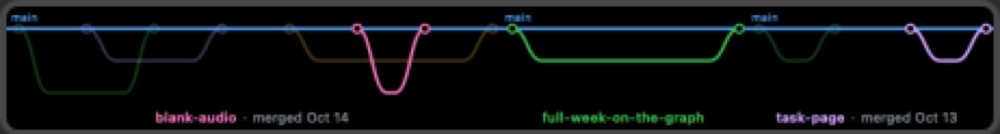

# 05 · The branch map

*October 15, 2026*

I wanted to see a repo's branches on my dials the way I picture them in my
head: main along the top, and every branch dipping off it and coming back.
A metro map, basically. This one ended up being more about GitHub's data
than about drawing.

## Looking at how someone else did it

There's already a branch dial out there: the Branch Network action in
Pedro Fuentes Schuster's **GitHub Utilities** plugin, which I have
installed. Its code is bundled JavaScript but still readable, so I read
how it works before starting mine.

It asks GitHub for the last 100 commits, then hands them to a port of
`git-graph` that lays the graph out as text, the `●│╭├` kind you get from
`git log --graph`. Then it turns every one of those characters into a
little piece of SVG. Clever, and it spans dials the same way my
full-width graph does.

Two things didn't fit what I wanted, though:

- It asks for commits without naming a branch, and GitHub answers that
  with main's history only. A branch that isn't merged yet has commits
  that never get fetched, and the graph code drops any branch whose
  newest commit it can't find. So the branches I'm still working on, the
  ones I most want to see, never show.
- It works out branch names but never draws them.

So I built mine from pull requests instead of commits.

## Problem 1: every old branch looked open

Two questions to GitHub: one for the branches and the last 20 merged pull
requests, and one asking, for each branch, how many commits it has that
main doesn't. "Ahead of main" means not merged. Easy.

Except `bigger-queue` was merged days ago and GitHub said it was 27
commits ahead.

> Wait, how is a merged branch ahead of main?

My pull requests get squash merged. That copies the branch's work onto
main as one brand new commit, so as far as git is concerned, the
branch's own commits never made it in. Every branch I didn't delete
after merging would have shown up as still open.

The fix: GitHub remembers the commit each pull request merged from. A
branch that's still sitting on exactly that commit is merged. If I keep
committing to it afterwards, it shows as open again, which is true.

## Problem 2: my pull requests are too short to see

I started with time along the strip, a month across four dials. Then I
looked at the actual times. `bigger-queue` was open for 29 minutes. On a
month that's less than one pixel.

So the map is in order, not to scale. Every "branch started" and "branch
merged" gets the same step along the strip, in the order they happened.
Real metro maps cheat exactly like this, and nobody has ever complained
that the Tube map isn't to scale. (Probably.)

## Problem 3: curves eat names

The first version had straight slants down from main. It worked, but it
looked like a circuit board. I wanted soft S-curves, so each bend is now a
curve that leaves main flat, drops, and levels off in its row.

Wider curves look nicer and take more room, and names were already tight:
on two dials, the loops ended up with no names at all. The trick was
noticing that the names don't have to wait for the curve to finish. Three
quarters of the way across, an S has already dropped below where the name
sits. So the names start there, and stop three quarters of the way before
the next curve.

## Problem 4: you couldn't tell what anything was

That fixed the crashes, and the real strip still read `fir…`, `ti…` and
`ta…`. Technically a label. Not actually information.

I looked at how other things handle it. Metro maps leave a station's name
off before they'd squash it. Git tools put the name at the branch tip. And
anything cramped on a computer shortens the name and shows the whole thing
when you hover. A dial can't hover, but it can turn.

I drew two versions with my real repos. In the first, names were never
cut and the map left lanes off to make room. Every name was readable, and
pomodoro-streamdeck on one dial showed 1 of its 7 branches. In the second,
the lanes have no names, one is picked, the rest fade back, and turning
moves the pick. I went with the second, because the overlapping lanes are
the part I actually like looking at.

The picked lane's name goes along the bottom with "still open" or "merged
Oct 14". That line took three tries on the real deck. Spaces around the
dot got squashed, then the nudge I used to space it out was ignored, so
now the name, the dot and the date are three separate bits of text, each
placed on its own.

Turning wraps around now, so going past the last lane lands on the first
instead of making me turn all the way back. And tapping opens whichever
lane is picked: the pull request for a merged one, since its branch is
usually deleted, or the branch itself if it's still open.

## Things that bit me along the way

| Problem | Fix |
|---|---|
| A merged branch counted as open | Same commit as its pull request means merged |
| Short pull requests were invisible | Even steps in order, not to scale |
| The newest branch forked right against the edge | "Now" gets its own step at the right end |
| Names ran into curves, then got cut to two letters | No names on lanes. Turn to pick one, and its name shows along the bottom |
| Typing a repo name saved after every letter, and a typo meant "not found" | A dropdown of my repos instead |
| My test deck echoed settings back and set off a refresh every second | Only refresh when the token or timer really changed |
| GitHub's GraphQL wants the full `repo` permission to say how far ahead a branch is, even on a public repo | Ask the REST compare instead, which doesn't care |
| The deck draws letters wider than Chrome | I measure my guesses on the real strip, not in the browser |
| The deck ignores spaces and `dx` between pieces of one text | Separate texts, each with its own position |
| A private repo says "Repo not found" | The `read:user` token can't read private repos. See the README |

**Lesson:** "ahead of main" sounds like it means "not merged". It doesn't,
not with squash merges. Git only knows about commits, not what I meant by
them.

## What's next

- Screenshot it for the README.
- Branches that only exist on my Mac. The plugin runs right next to my
  repos, so it could ask git directly. GitHub can't see those at all.
- Maybe turning the dial to scroll back further than the last 20 merges.
