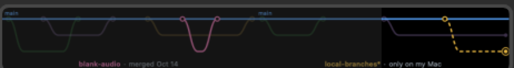

# 06 · Only on my Mac

*October 15, 2026*

The branch map only knew what GitHub knew. But half my branches spend
their first hour on my Mac before I push them, and those are the ones I'm
actually working on. GitHub can't see them. My Mac can.



That's github-graph on the right two dials, and the dashed yellow lane is
the branch I built this on, before it ever went to GitHub. The `*` after
its name and the ring on its dot mean I had changes I hadn't committed
yet. (I had a lot of them. It was the branch I was writing.)

## How it asks

The plugin is just a Node program running on my Mac, so it can run git
the same way I do in Terminal. All my repos live in `~/Projects`, in
folders named the same as on GitHub, so finding the right one is easy.

```
dial refreshes
  → GitHub: branches and merged pull requests (same as before)
  → git in ~/Projects/github-graph:
      for-each-ref   # every branch I have, and the commit it's on
      status         # which one is checked out, anything uncommitted?
      log            # per branch: how many commits main doesn't have
  → anything GitHub doesn't have becomes a dashed lane
```

Dashed because it's a metro map, and on a metro map a dashed line is the
route that's planned but not built yet. Which is exactly what an unpushed
branch is.

No folder, or a folder that isn't a repo, and it just shows GitHub's map
like before. No error. Local branches are a bonus, not something to
complain about.

## Three ways it was quietly wrong first

**The dates were in different time zones.** GitHub writes times in UTC,
like `19:30:11Z`. git writes them in mine, like `14:30:11-05:00`. Same
moment. But the map sorts dates as plain text, and as text those two
aren't even close. A local branch would have landed in a random spot. Now
git's dates get turned into GitHub's format before anything sorts them.

**My merged branches would have come back.** After a pull request merges,
GitHub deletes its branch, but my Mac keeps its copy. And since I squash
merge, git says that copy is still ahead of main (the same squash problem
from [entry 05](05-the-branch-map.md), back for a sequel). The same fix
works: if my local branch is on exactly the commit its pull request
merged from, it's merged.

**`git status` isn't read-only.** I found this one writing the README,
right as I typed "it never changes anything in the repo". git status
quietly tidies its index file while it looks, and it locks the file to do
it. If the dial refreshed in the middle of me committing, my commit could
fail with `index.lock exists`. git has a flag for exactly this,
`--no-optional-locks`, so now every command the plugin runs uses it.

Tapping a local lane can't open it on GitHub, since it isn't there. It
shows the dial's little warning sign instead of opening a 404.

**Lesson:** the same moment can be two different strings. Anything that
compares dates as text needs them all written the same way first.

## What's next

- Local branches only update when the map refreshes. Watching the repo
  folder would make a new branch show up the moment I make it, but a
  press works for now.
- Maybe a tap on a local lane could open its folder in Finder, instead
  of just the warning sign.
