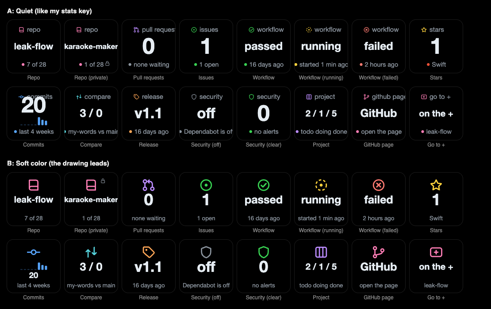

# 07 · Keys that teach me GitHub

*October 15, 2026*

I've been using the GitHub Utilities plugin and liking what it does, just
not how it looks. Every key is three lines of text under a colored bar, on
GitHub's dark gray. So I'm making my own versions, keys only, and every
one of them has to explain itself, because half the point is learning what
all these GitHub words mean.

This first batch is the groundwork plus three keys: Repo, Pull Requests,
Issues and Workflow.

## Reading his first

Before drawing anything I read through how his keys actually work. A few
things I decided not to copy:

- When a request fails, his PR and issue keys show **0**. A dead token
  looks exactly like a repo with nothing open.
- Two keys on the same repo can show each other's numbers.
- His settings pages say "press to refresh", and a press actually opens
  GitHub.
- The backgrounds are `#0d1117`, the gray square I already banned from my
  deck once. (Twice now.)

## Picking a look

I drew every key two ways with real numbers from leak-flow.

I expected to pick the top one, since it's the layout of my stats key.
Then I saw it. The labels ran off the edges ("pull reques") and the commit
count crashed into its little bars. The bottom one leads with the drawing,
like my daily goal ring and the streak fire do, and it just looks calmer.
Bottom one it is.

## One repo, every key

The **Repo** key shows a repo, and a press steps to the next one, newest
push first. Every other key starts on "Follow the Repo key", so they all
switch together. I can still pin one key to a repo in its settings.

> Why doesn't pressing the Repo key open GitHub like the others?

Because I'd be stepping through repos and keep getting thrown into the
browser. It's the one key where a press means "next".

The repo picker in the settings has a search box and a small drawn lock on
private repos. His uses a lock emoji. A normal dropdown can only hold text,
so mine is built by hand to fit a real drawing.

## The settings pages teach

Every key's page has the same rows as my Mac Vitals keys: **This is**,
**Right now**, **Normal**, **Words to know**, **Try this** and **A press**.
"Right now" is written by the plugin from the key's latest numbers, so it
says things like "1 open issue on leak-flow. The oldest is from 3 days
ago." instead of a bare number.

## Things that bit me

| Problem | Fix |
|---|---|
| Node's test runner can't load a file whose imports leave off `.ts` | TypeScript's `rewriteRelativeImportExtensions` lets the new files write `.ts` and still build |
| "karaoke-maker" needed 129 pixels and I'd given it 128, so it got cut | The middle line gets 136 of the key's 144 |
| With no token, the Repo key said "loading" forever | It says "No token" in soft red now, like the other keys |
| My new REST helper and the branch compare did the same thing twice | The compare goes through the helper |

**Lesson:** I almost picked the style that looked like what I already had.
Drawing both with real data took ten minutes and changed my mind.

## What's next

Repo Stats, Commit Activity and Branch Comparison, then Releases, Security
and Projects, then the profiles that put all of it on my XL and my +.
