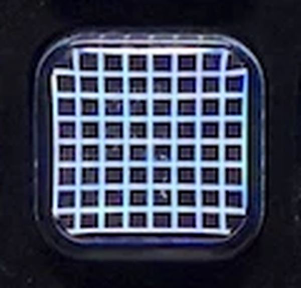

# 17 · The cap is a lens

*October 27, 2026*

I wanted the contribution graph on a key, not just the dials. One
evening, one action, how hard could it be. The action took an hour.
Making it look right on the actual key took the rest of the night, and
most of that was finding out that a Stream Deck key cap is a lens.

## A key is square and a week is seven

The dial graph is 14 weeks wide and 7 days tall, which fits a strip
that's twice as wide as it is tall. A key is 144 by 144. Seven of
anything one way and fourteen the other can't fill a square with square
squares. I tried every way round it:

| Try | What it looked like |
|---|---|
| 7 days across, 10 weeks down, 12px squares | A bookmark: black down both sides |
| 12 weeks across, 7 days down, 11px squares | Black top and bottom instead |
| 12 by 12 of plain days, no weekday columns | Filled the key, 144 days, squares like confetti |
| 10 by 10 at 12px | Still too small on the real key |
| 8 by 8 at 14px with a 9px margin | Readable, and it looked like a sticker on the key |

That last one is where I learned the first lesson of the night: the
Stream Deck app's window is not the deck. Every one of those looked fine
in the app. On the XL the 10px squares were a green smudge and the 8 by
8 sat in the middle of the key like something I'd stuck on.

## Falling off the end

What I actually wanted was for the grid to be the key, the way the app
icons on the deck fill theirs right to the rim. So the grid got bigger
until it ran off the edge. Seven squares across, which means the rows
could be real weeks again, Sunday on the left, newest week on top.

Then a detour I'm a little embarrassed by: a rounded tile under the
grid, then the tile grown to the whole key with a shine on it, then a
highlight on every single square to make them "bubble". The bubbles
were ugly. I took them out within the minute. What I'd been trying to
describe to myself as "convex" and "raised" was never a shine. It was the
outer edge of the grid meeting the outer edge of the key.

## Thirds

The XL draws each key at 96 pixels. The plugin draws at 144, the size
Elgato asks for, and the deck shrinks it by two thirds. My 20px squares
with 1px gaps became 13.33px squares with 0.67px gaps, and two thirds of
a pixel of black can't exist, so every gap got smeared into gray. That
was the "blurry" I'd been seeing.

The fix is arithmetic. Anything that's a multiple of 1.5 at 144 lands
on a whole pixel at 96. So the squares are 18 with a 3px gap: 12 and 2
on the panel, pin sharp. And seven of those is exactly 144, so the grid
touches every edge of the key without me having to offset anything.
That one felt like finding a coin in a coat pocket.

## The cap

Sharp squares, straight rows, and the key still looked like I was
wearing someone else's glasses. Not blurry. Magnified at the edges, like
a prescription one step too strong.

That's the cap. The XL isn't 32 little screens, it's one LCD with a grid
of clear plastic plungers sitting over it, and each plunger has a
slightly domed top. A domed piece of clear plastic is a lens. The middle
of the picture comes through straight and the outer ring bends. The app
window shows the raw pixels with no plastic in the way, which is why it
never shows up there.

> Can I draw the picture pre-bent, so the cap bends it back straight?

Camera software does this for lenses, so in theory yes. Nobody has
published the curve of a Stream Deck cap. The one thing I found was a
2017 Reddit comment from someone correcting key text in Photoshop with
the lens filter at -9. So I measured my own.

I put a measuring grid on the key, white lines every 12 panel pixels and
a pink dot in the middle, and photographed it from where I sit.



The sides bulge. The top row is squashed too, but that's perspective:
I look down at the deck, not straight at it.

## Getting the bend wrong, then right

I read the photo as "sides bulge out, so pinch the drawing in". On the
deck that was worse. Flipped it: draw the grid bowed outward, and the
lines went straight. 🎉 Then the key looked like a globe, because
bending the whole grid is a globe. Changed the math so the middle stays
flat and only the outer ring moves (distance to the fourth power
instead of squared). Then it was a bow of 8 percent, then 5, 3, 2, 1.8,
and 1.9. Under 2 percent the corners move about a panel pixel and a
half, which turns out to be exactly enough.

Two more small things, both from looking at the key rather than the
app. The bow is centered 8 pixels above the middle of the key, because
from a chair above the deck that's where the cap's center is. And the
top row reaches one panel pixel past the rim, because looking down at a
key foreshortens its top edge and leaves a black sliver there. Every
key on the deck has that sliver. Mine's just the one with straight
lines to give it away.

I also tried snapping the bent corners back onto whole pixels for crisp
edges. It made the outer ring uneven and didn't change the feel. Out.

What's left is the cap's magnification itself, and no drawing changes
that. The lines are straight now. The glasses are still a little strong.

## How it works

```
GitHub → one shared download → 7 week columns → 49 squares
       → each corner through lens(x, y) → polygon → key
```

`lens()` is nine lines. It takes a point of the 144 picture and moves it
away from a center just above the middle by 1.9 percent of its distance
to the fourth power, scaled so the sides sit a pixel past the rim. Zero
draws it flat. Pressing the key opens my GitHub profile. There are no
words on it; gray means go look at the Status line, same as the dial.

## What I learned

- The Stream Deck app window is not the deck, for size or for shape.
  Only the key is the key.
- Draw XL key art in multiples of 1.5. The deck shrinks 144 to 96, and
  fractions of a pixel turn into gray.
- A key cap is a lens. A 2 percent outward bow in the outer ring,
  centered a little above the middle, cancels it from my chair.
- A photo of the key answered in one look what six guesses at "convex"
  couldn't. Next time I can't describe a look, I take the picture first.

**Still to do:** a photo of the finished key next to the Activity key
for the README, and the commit. I wanted to sit with it on the deck
first.
